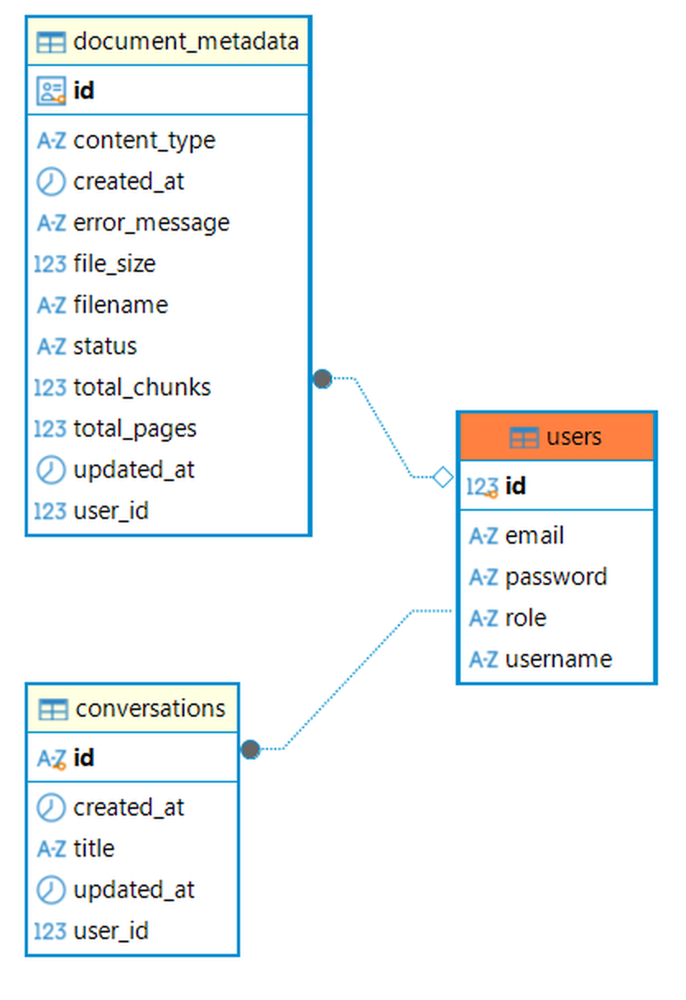
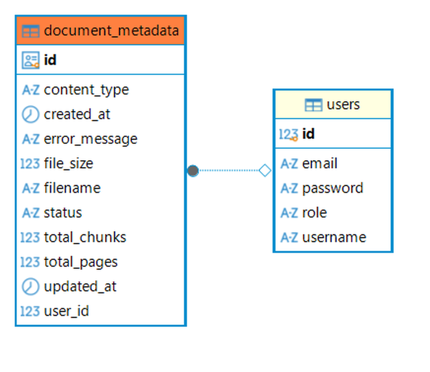
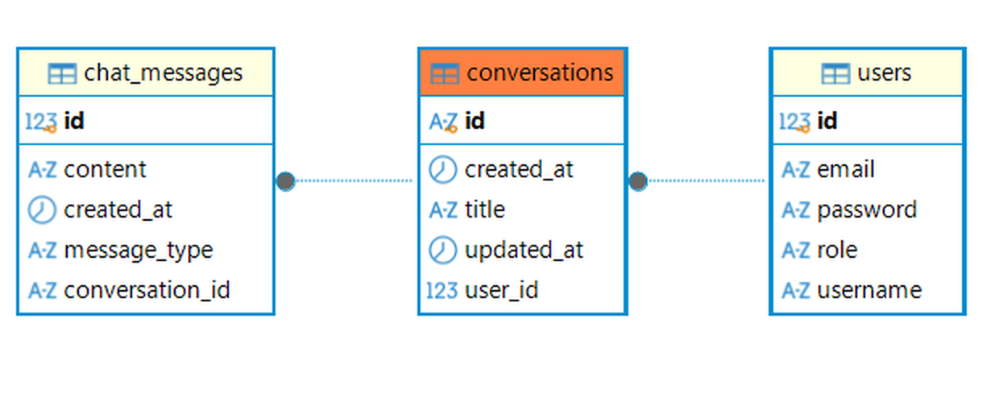
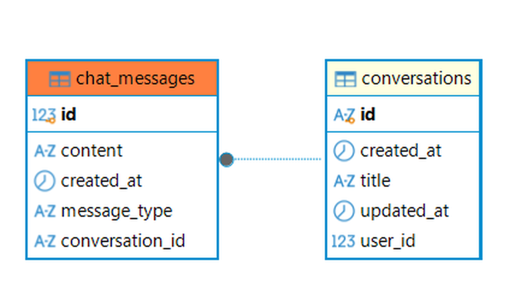
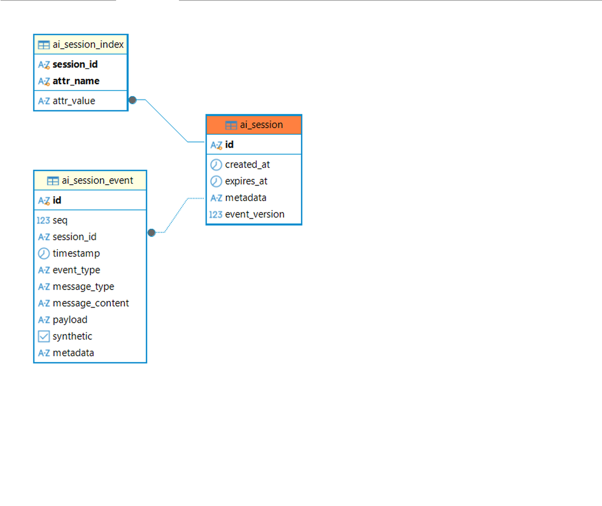
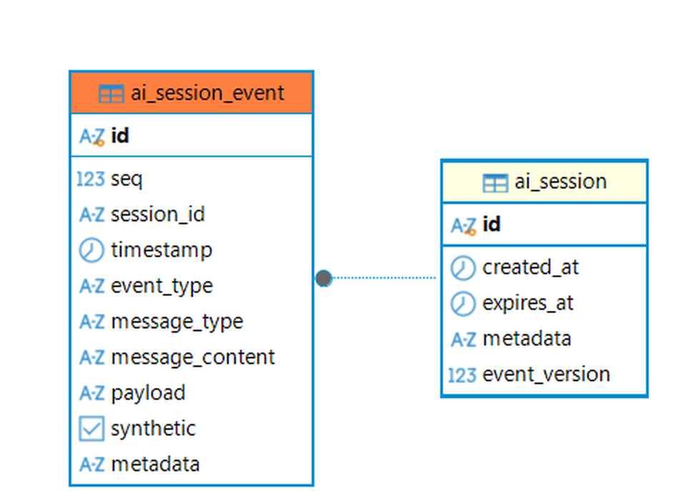
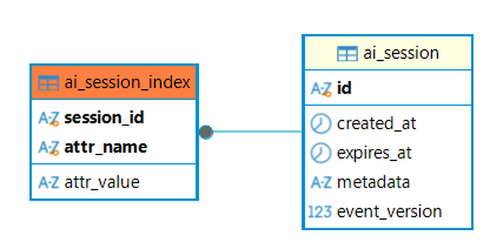
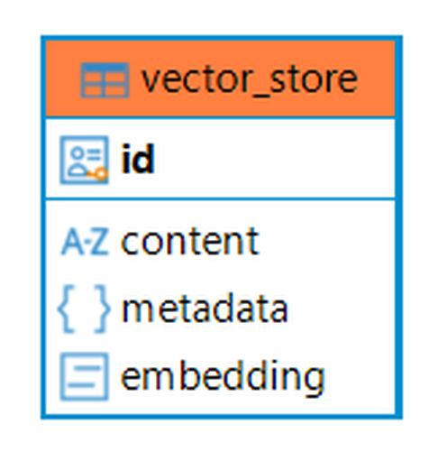

# DocMind Database Schema & ERD Architecture Specification

**Definitive Schema Reference, DBeaver ERD Analysis, and Production Engineering Standards**

- **Document Version:** 2.5.0 (Production Architecture Standard)
- **Author:** Senior Engineering Manager & Core Platform Engineering Team
- **Audience:** Backend Engineers, Data Architects, AI/ML Platform Specialists
- **Classification:** Internal Engineering Standard / Strictly Confidential
- **Engines:** PostgreSQL 16.x + pgvector Extension | Spring Data JPA / Hibernate | Spring AI JDBC Session Repository
- **Total Tables:** 8 Tables (`users`, `document_metadata`, `vector_store`, `conversations`, `chat_messages`, `ai_session`, `ai_session_event`, `ai_session_index`)

---

## 1. Core Multi-Tenant Relational Hub

The DocMind relational core manages tenant identity, document metadata cataloging, and user conversation history. It enforces strict relational multi-tenancy where all assets fan out from the authenticated tenant primary key in `users.id`.

### 1.1 Multi-Tenant Central Hub: `users`, `document_metadata` & `conversations`

The central DBeaver ER diagram illustrates `users` as the primary tenant anchor. It connects outward via one-to-many foreign key relationships to both `document_metadata` (uploaded files) and `conversations` (chat sessions):

<div align="center">
  
  <p><em>Figure 1.1: DBeaver ERD — Multi-Tenant Central Hub (users ||--o{ document_metadata and users ||--o{ conversations)</em></p>
</div>

#### Relational Topology & Cascade Rules:
- **`users ||--o{ document_metadata`**: A single user owns zero or more uploaded documents. The foreign key terminates on `document_metadata.user_id`.
- **`users ||--o{ conversations`**: A single user owns zero or more conversation threads. The foreign key terminates on `conversations.user_id`.
- **Cascade Deletion**: Both child tables enforce `ON DELETE CASCADE`. Purging a user record automatically cleans all associated documents and chat history.

#### Table Specification: `users`
| Column | DBeaver Icon | SQL Type | Constraint | Business & Operational Role |
|---|---|---|---|---|
| `id` | `123 (Key)` | `BIGINT` | `PK (Identity)` | Unique 64-bit integer assigned to each registered user. Anchor for multi-tenancy. |
| `username` | `A-Z` | `VARCHAR(50)` | `NOT NULL, UNIQUE` | Unique login handle; alphanumeric validation enforced in `AuthRequestDto`. |
| `email` | `A-Z` | `VARCHAR(255)` | `NOT NULL, UNIQUE` | RFC-5322 primary user email. Used for authentication and notifications. |
| `password` | `A-Z` | `VARCHAR(255)` | `NOT NULL` | Cryptographic salted BCrypt hash (`$2a$12$`). Plaintext is rejected at DTO layer. |
| `role` | `A-Z` | `VARCHAR(20)` | `NOT NULL` | RBAC authority: `ROLE_USER` (standard tenant) or `ROLE_ADMIN` (platform administrator). |

---

### 1.2 Document Ingestion & Cataloging: `document_metadata` <-> `users`

Every file uploaded via `/api/v1/documents/upload` creates an immutable entry in `document_metadata` referencing the authenticated user:

<div align="center">
  
  <p><em>Figure 1.2: DBeaver ERD — Document Ingestion Catalog (document_metadata linked to users)</em></p>
</div>

#### Table Specification: `document_metadata`
| Column | DBeaver Icon | SQL Type | Constraint | Business & Operational Role |
|---|---|---|---|---|
| `id` | `ID Card / Key` | `UUID` | `PK` | Cryptographically generated UUIDv4 uniquely identifying the uploaded document. |
| `user_id` | `123` | `BIGINT` | `FK -> users(id)` | Owner reference. Guaranteed non-null; enforces strict tenant boundaries. |
| `filename` | `A-Z` | `VARCHAR(255)` | `NOT NULL` | Sanitized source filename as uploaded by the user. |
| `content_type` | `A-Z` | `VARCHAR(100)` | `NOT NULL` | MIME type of document (e.g., `application/pdf`, `text/plain`). |
| `file_size` | `123` | `BIGINT` | `NOT NULL` | Physical payload size in bytes. |
| `total_pages` | `123` | `INT` | `NULLABLE` | Total physical pages detected in paginated documents (e.g., PDF). |
| `total_chunks` | `123` | `INT` | `NOT NULL` | Total number of semantic chunks generated during tokenization (default `0`). |
| `status` | `A-Z` | `VARCHAR(20)` | `NOT NULL` | Pipeline state machine: `UPLOADING` → `PROCESSING` → `INDEXED` \| `FAILED`. |
| `error_message` | `A-Z` | `VARCHAR(1000)` | `NULLABLE` | Parser stack trace or failure diagnostic note if processing fails. |
| `created_at` | `Clock` | `TIMESTAMP` | `NOT NULL` | UTC timestamp of document submission. |
| `updated_at` | `Clock` | `TIMESTAMP` | `NOT NULL` | UTC timestamp of last status transition or chunk index completion. |

---

### 1.3 User Conversational Audit Trail: `chat_messages` -> `conversations` -> `users`

The complete relational chat hierarchy connects user ownership through conversations down to individual message exchanges:

<div align="center">
  
  <p><em>Figure 1.3: DBeaver ERD — Complete Chat Hierarchy (chat_messages -> conversations -> users)</em></p>
</div>

<div align="center">
  
  <p><em>Figure 1.4: DBeaver ERD — Focused Conversation to Message Relational Link</em></p>
</div>

#### Relational Flow & Cascade Rules:
- **`chat_messages -> conversations`**: `conversation_id` references `conversations.id` with `ON DELETE CASCADE`.
- **`conversations -> users`**: `user_id` references `users.id` with `ON DELETE CASCADE`.
- When a user deletes a conversation in the UI, all associated `chat_messages` are atomically purged by the database engine.

#### Table Specification: `conversations`
| Column | DBeaver Icon | SQL Type | Constraint | Business & Operational Role |
|---|---|---|---|---|
| `id` | `A-Z (Key)` | `VARCHAR(255)` | `PK` | Coordinated UUID string. Identical to Spring AI `ai_session.id`. |
| `user_id` | `123` | `BIGINT` | `FK -> users(id)` | Tenant ownership key. Ensures users can only access their own threads. |
| `title` | `A-Z` | `VARCHAR(255)` | `NOT NULL` | Thread display title in the UI, auto-initialized from opening user prompt. |
| `created_at` | `Clock` | `TIMESTAMP` | `NOT NULL` | UTC creation timestamp of the conversation thread. |
| `updated_at` | `Clock` | `TIMESTAMP` | `NOT NULL` | Timestamp of most recent message exchange (indexed for sidebar sorting). |

#### Table Specification: `chat_messages`
| Column | DBeaver Icon | SQL Type | Constraint | Business & Operational Role |
|---|---|---|---|---|
| `id` | `123 (Key)` | `BIGINT` | `PK (Identity)` | Monotonically increasing message ID for chronological UI rendering. |
| `conversation_id`| `A-Z` | `VARCHAR(255)` | `FK -> conv(id)` | Parent thread identifier. Indexed for fast sequential retrieval. |
| `message_type` | `A-Z` | `VARCHAR(20)` | `NOT NULL` | Role classification: `USER` (question), `ASSISTANT` (AI reply), `SYSTEM`. |
| `content` | `A-Z` | `TEXT` | `NOT NULL` | Full raw text content of user query or LLM generated response. |
| `created_at` | `Clock` | `TIMESTAMP` | `NOT NULL` | Message insertion timestamp (UTC). |

---

## 2. Spring AI Low-Latency Session Memory Subsystem

In addition to the JPA chat audit trail, DocMind deploys Spring AI's official JDBC Session Repository schema. This tier acts as a stateful, high-throughput context buffer that feeds the active sliding window (last 10 turns) directly into LLM prompts via `MessageChatMemoryAdvisor`, completely decoupling prompt assembly from relational JPA overhead.

### 2.1 Spring AI Session Ecosystem: `ai_session`, `ai_session_event` & `ai_session_index`

The `ai_session` table serves as the session root, flanked by `ai_session_event` (event journal) and `ai_session_index` (attribute lookup):

<div align="center">
  
  <p><em>Figure 2.1: DBeaver ERD — Spring AI Session Ecosystem (ai_session Root, ai_session_event Journal & ai_session_index)</em></p>
</div>

### 2.2 Event Journaling & Dynamic Attributes

<div align="center">
  
  <p><em>Figure 2.2: DBeaver ERD — Spring AI Session Event Journal (ai_session_event linked to ai_session)</em></p>
</div>

<div align="center">
  
  <p><em>Figure 2.3: DBeaver ERD — Spring AI Session Attribute Index (ai_session_index linked to ai_session)</em></p>
</div>

#### Table Specification: `ai_session`
| Column | DBeaver Icon | SQL Type | Constraint | Business & Operational Role |
|---|---|---|---|---|
| `id` | `A-Z (Key)` | `VARCHAR(36)` | `PK` | Session UUID string matching `conversations.id`. |
| `created_at` | `Clock` | `TIMESTAMP` | `NOT NULL` | Session initialization timestamp. |
| `expires_at` | `Clock` | `TIMESTAMP` | `NULLABLE` | TTL threshold for automated background cache expiration. |
| `metadata` | `A-Z` | `TEXT` | `NULLABLE` | Serialized JSON session configuration and runtime parameters. |
| `event_version`| `123` | `INT` | `NOT NULL` | Optimistic locking version counter preventing concurrent write conflicts. |

#### Table Specification: `ai_session_event`
| Column | DBeaver Icon | SQL Type | Constraint | Business & Operational Role |
|---|---|---|---|---|
| `id` | `A-Z (Key)` | `VARCHAR(36)` | `PK` | Unique event identifier UUID. |
| `seq` | `123` | `INT` | `NOT NULL` | Strictly increasing sequence number defining event order within session. |
| `session_id` | `A-Z` | `VARCHAR(36)` | `FK -> ai_session(id)`| Parent session reference (`ON DELETE CASCADE`). |
| `timestamp` | `Clock` | `TIMESTAMP` | `NOT NULL` | UTC timestamp of the interaction. |
| `event_type` | `A-Z` | `VARCHAR(50)` | `NOT NULL` | Event tag: `MESSAGE`, `TURN_START`, `TOOL_EXECUTION`. |
| `message_type`| `A-Z` | `VARCHAR(50)` | `NULLABLE` | Spring AI message type: `USER`, `ASSISTANT`, `SYSTEM`. |
| `message_content`| `A-Z` | `TEXT` | `NULLABLE` | Passage text injected into the LLM context buffer. |
| `payload` | `A-Z` | `TEXT` | `NULLABLE` | Serialized JSON execution state, function calling parameters, or tokens. |
| `synthetic` | `Checkbox` | `BOOLEAN` | `NOT NULL` | True if message was synthesized by RAG advisor; False if raw user input. |
| `metadata` | `A-Z` | `TEXT` | `NULLABLE` | Supplemental telemetry, token usage counts, and finish reasons. |

#### Table Specification: `ai_session_index`
| Column | DBeaver Icon | SQL Type | Constraint | Business & Operational Role |
|---|---|---|---|---|
| `session_id` | `A-Z (Key)` | `VARCHAR(36)` | `FK -> ai_session(id)`| Session reference key. |
| `attr_name` | `A-Z (Key)` | `VARCHAR(100)` | `NOT NULL` | Session attribute name/key for fast lookup. |
| `attr_value` | `A-Z` | `VARCHAR(255)` | `NULLABLE` | Session attribute string value. |

---

## 3. High-Dimensional Semantic Vector Space (`pgvector`)

The `vector_store` table is the semantic foundation of DocMind's RAG pipeline. It stores tokenized document chunk passages alongside 1536-dimensional embeddings generated by OpenAI's `text-embedding-3-small` model.

### 3.1 Vector Store Schema: `vector_store`

<div align="center">
  
  <p><em>Figure 3.1: DBeaver Table Schema — vector_store (id, content, metadata JSONB, embedding VECTOR)</em></p>
</div>

#### Table Specification: `vector_store`
| Column | DBeaver Icon | SQL Type | Indexing Strategy | Business & Operational Role |
|---|---|---|---|---|
| `id` | `ID Card / Key` | `UUID` | `PRIMARY KEY (B-Tree)` | Unique UUID assigned to the individual text chunk passage. |
| `content` | `A-Z` | `TEXT` | `GIN Full-Text (Optional)` | The raw textual chunk passage extracted from the document for LLM context injection. |
| `metadata` | `{ } (JSON)` | `JSONB` | `GIN (jsonb_path_ops)` | JSON payload containing `userId`, `documentId`, `fileName`, `chunkIndex`, `pageNumber`. |
| `embedding` | `Bar List` | `VECTOR(1536)` | `HNSW (vector_cosine_ops)` | 1536-dimensional dense embedding vector produced by OpenAI `text-embedding-3-small`. |

### 3.2 JSONB Metadata Attributes & Multi-Tenant Query Execution
- **`userId` (VARCHAR)**: Multi-tenant boundary key. Ensures searches strictly filter within the authenticated user's document corpus.
- **`documentId` (VARCHAR)**: Foreign reference to parent `document_metadata.id`; enables single-document scoped chat.
- **`fileName` (VARCHAR)**: Source filename for inline citations in AI answers.
- **`contentType` (VARCHAR)**: MIME type of the original document.
- **`chunkIndex` (INT)**: 0-based sequence number of the chunk inside the document.
- **`pageNumber` (INT)**: 1-based page number (for PDF citations).

#### Production HNSW Index DDL & Cosine Distance Formula:
$$\text{Cosine Similarity}(A, B) = 1.0 - (A \Leftrightarrow B) = \frac{A \cdot B}{\|A\| \|B\|}$$

```sql
CREATE INDEX idx_vector_store_embedding 
ON vector_store 
USING hnsw (embedding vector_cosine_ops) 
WITH (m = 16, ef_construction = 64);
```

---

## 4. Consolidated Master Data Dictionary

| Table Name | Domain Subsystem | Primary Key | Foreign Keys | Total Columns | Operational Role |
|---|---|---|---|---|---|
| `users` | Identity & Multi-Tenancy | `id (BIGINT)` | None | 5 | Tenant anchor, authentication, BCrypt credentials, RBAC. |
| `document_metadata` | Document Ingestion | `id (UUID)` | `user_id -> users(id)` | 11 | File catalog, byte sizes, chunk counters, state machine. |
| `vector_store` | pgvector Semantic Search | `id (UUID)` | None (JSONB `documentId`) | 4 | 1536-dim embeddings, text chunks, HNSW cosine index. |
| `conversations` | Conversational Audit | `id (VARCHAR)` | `user_id -> users(id)` | 5 | Chat thread metadata, user ownership, UI sidebar display. |
| `chat_messages` | Conversational Audit | `id (BIGINT)` | `conversation_id -> conv(id)`| 5 | Persistent message ledger, chronological chat history. |
| `ai_session` | Spring AI Session Memory | `id (VARCHAR)` | None (Shared UUID) | 5 | Active session root, TTL expiration, optimistic locking. |
| `ai_session_event` | Spring AI Session Memory | `id (VARCHAR)` | `session_id -> ai_session(id)`| 10 | Turn-by-turn event stream, pre-serialized prompt context. |
| `ai_session_index` | Spring AI Session Memory | `(session_id, attr_name)`| `session_id -> ai_session(id)`| 3 | Dynamic session attribute key-value index. |

---

## 5. Production Indexing & Maintenance Guidelines

| Index Name | Target Table | Columns & Index Type | Query Acceleration Target |
|---|---|---|---|
| `idx_users_username` | `users` | `username (B-Tree, UNIQUE)` | Accelerates login lookup by username. |
| `idx_users_email` | `users` | `email (B-Tree, UNIQUE)` | Enforces unique registration and email authentication. |
| `idx_doc_meta_user_created` | `document_metadata` | `user_id, created_at DESC (Composite B-Tree)` | Powers user document catalog dashboard: `WHERE user_id = ? ORDER BY created_at DESC`. |
| `idx_vector_embedding_hnsw` | `vector_store` | `embedding (HNSW, vector_cosine_ops)` | Accelerates approximate nearest neighbor vector search (`<=>`). |
| `idx_vector_metadata_gin` | `vector_store` | `metadata (GIN, jsonb_path_ops)` | Accelerates JSONB tenant containment queries: `metadata @> '{"userId":"1"}'`. |
| `idx_conv_user_updated` | `conversations` | `user_id, updated_at DESC (Composite B-Tree)` | Optimizes user conversation sidebar: `WHERE user_id = ? ORDER BY updated_at DESC`. |
| `idx_chat_msg_conv_created` | `chat_messages` | `conversation_id, created_at ASC (Composite B-Tree)` | Enables sequential message retrieval for chat history rendering. |
| `idx_ai_session_event_lookup` | `ai_session_event` | `session_id, seq ASC (Composite B-Tree)` | Powers sliding window retrieval for Spring AI LLM prompts. |
