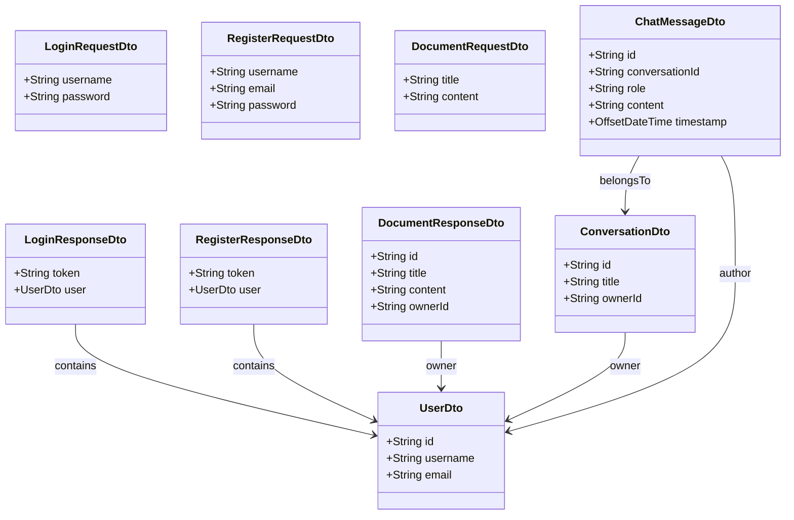
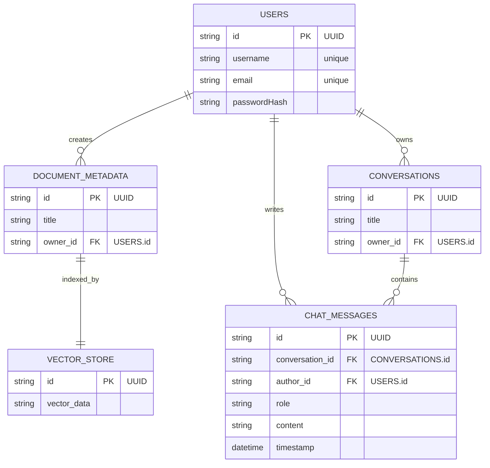
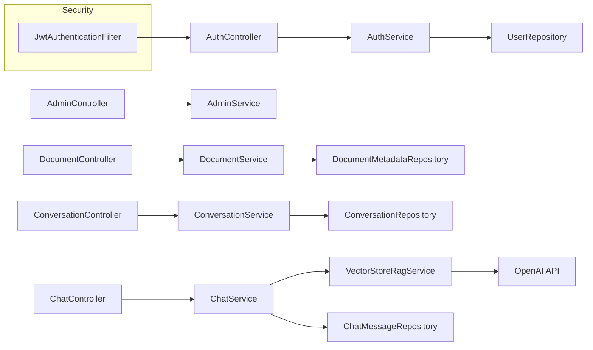

# DocMind Backend Architecture Diagrams

Below are three Mermaid diagrams that capture the current backend design.  They are based on the Java source that lives under `src/main/java/com/ramanuj/docmind/`.

---

## 1️⃣ DTO Class Diagram

---

## 2️⃣ Entity‑Relationship Diagram

---

## 3️⃣ Controller‑to‑Service Flow Diagram

---

*All diagrams use GitHub‑compatible Mermaid syntax and can be viewed directly in the repository’s markdown preview.*
